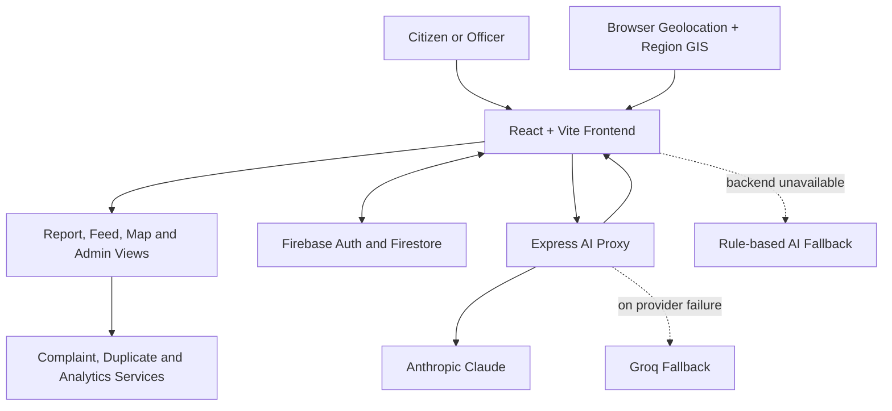

<div align="center">

# CrowdSense AI

### Civic issues in. Actionable civic intelligence out.

An AI-assisted civic issue reporting and resolution prototype focused on **Bhopal, Madhya Pradesh**.

[**Open the Live Demo ↗**](https://crowdsenseaibhopal.vercel.app) · [View Source Code](https://github.com/hakamcodes/Crowd_SenseAI_bhopal)


**Project context:** Claude Impact Lab

</div>

---

## The idea

Civic complaints often arrive as disconnected reports: a description here, a location there, and several people reporting the same problem separately. CrowdSense AI brings those reports into one workflow.

People can report an issue with a description, photo and location context. The application classifies the report, estimates its priority and civic impact, looks for likely duplicates, and makes the resulting complaint visible in a public feed and map. Authorized officers get role-scoped tools to review, assign and track complaints, while the admin dashboard summarizes workload, hotspots and resolution performance.

> **Demo status:** CrowdSense AI is a working prototype for demonstration and evaluation. It is not an official Bhopal Municipal Corporation service. AI classifications and recommendations should be reviewed by people rather than treated as final decisions.

## Try the demo

### [Launch CrowdSense AI](https://crowdsenseaibhopal.vercel.app)

Explore the application, including its complaint feed, map and reporting workflow. The exact data and authentication behavior depend on the live deployment's configuration.

## What is implemented

### For citizens

- **Report a civic issue** with a written description, an issue photo and available location details.
- **Location context** using browser geolocation, address information and the configured region's ward/zone data.
- **AI-assisted triage** that suggests a category, subcategory, priority, severity score, summary, department, recommended action, tags, confidence, risk indicators and civic-impact score.
- **Likely-duplicate detection** using location proximity, ward/zone, category, text similarity, image-hash similarity and report recency.
- **Support an existing report** when a similar complaint is found, instead of creating another copy.
- **Public complaint feed** with text search and status/category filters.
- **Complaint detail and status timeline** so a report's recorded progress can be inspected.
- **Map view** with filters for status, category, priority and ward.
- **My Complaints, Supported Issues and Settings** for signed-in users.

### For officers and administrators

- **Role-based views** for junior officers, senior officers and super administrators.
- **Scoped complaint access:** junior officers see complaints assigned to them; senior officers see complaints in their zone; super administrators can access all complaints.
- **Complaint management** for reviewing reports, updating status, assigning officers and adding administrative notes.
- **Resolution evidence:** a complaint cannot be marked **Resolved** unless a resolution photo is attached.
- **SLA tracking and escalation signals** based on complaint priority and elapsed time.
- **Analytics dashboard** covering complaint status, priority, ward/zone distribution, hotspots, trends, department performance, officer performance, resolution rate and average resolution time.
- **AI-generated civic briefing** based on statistics already computed by the application.
- **Officer management** for the super administrator, including maintaining the officer roster and zone assignments.
- **In-app notifications** associated with complaint assignment and escalation workflows.

### AI and fallback behavior

CrowdSense AI uses a layered approach rather than making the interface completely dependent on an AI API:

1. The frontend sends classification and briefing requests to the Express backend proxy when `VITE_BACKEND_API_BASE_URL` is configured.
2. The backend tries **Anthropic Claude** first.
3. If the Anthropic request fails, the backend tries **Groq** as a fallback provider.
4. If the backend is missing or unavailable, the frontend falls back to deterministic, rule-based classification and a template briefing.

The primary Anthropic classification request can include an uploaded image as well as the text description. The Groq and local rule-based fallbacks are text-driven. The structured result includes category, priority, severity, risk indicators and recommended routing information. Duplicate detection is a separate application service; a duplicate suggestion is not an automatic proof that two reports describe the same event.

## How it works



The web application and AI proxy have separate responsibilities. **Firebase Auth and Firestore are accessed directly by the frontend SDK** when Firebase is configured; the Express backend is a small proxy for AI requests and keeps the Anthropic/Groq API keys on the server.

## Technology stack

| Layer | Technologies used in this repository |
|---|---|
| Frontend | React 19, JavaScript/JSX, Vite 7, React Router 7 |
| Styling and UI | Tailwind CSS 3, Lucide React |
| Maps and geospatial processing | Leaflet, Turf.js, GeoJSON, browser geolocation |
| Location lookup | OpenStreetMap Nominatim for reverse geocoding |
| Authentication and data | Firebase Authentication, Cloud Firestore; browser `localStorage` prototype store when Firebase is not configured |
| AI classification and briefings | Anthropic Claude API, Groq API fallback, local deterministic heuristic fallback |
| Backend | Node.js, Express 4, Helmet, CORS, `express-rate-limit` |

## Project structure

```text
Crowd_SenseAI_bhopal/
├── frontend/
│   ├── src/
│   │   ├── components/       # Layout, complaint, map and reusable UI components
│   │   ├── config/           # Regions, issue types, sample records and SLA settings
│   │   ├── pages/            # Citizen pages, map and admin pages
│   │   ├── services/         # AI, complaints, duplicates, analytics, officers and GIS logic
│   │   ├── state/            # Authentication and application data contexts
│   │   └── utils/            # Geolocation, images, dates and text helpers
│   ├── scripts/              # GIS conversion script
│   ├── .env.example
│   └── package.json
├── backend/
│   ├── server.js             # AI proxy and health endpoint
│   ├── .env.example
│   └── package.json
└── .gitignore
```

### Main application routes

| Route | Purpose |
|---|---|
| `/` | Home page |
| `/signin` | Sign in or create an account |
| `/report` | Submit a civic issue |
| `/complaints` | Public complaint feed |
| `/complaints/:complaintId` | Complaint details and progress |
| `/map` | Geospatial complaint view |
| `/my-complaints` | Current user's reports |
| `/supported` | Complaints the user supports |
| `/settings` | User settings |
| `/admin` | Officer/admin dashboard |
| `/admin/complaints` | Complaint administration |
| `/admin/analytics` | Analytics and trends |
| `/admin/zones` | Zone management view |
| `/admin/officers` | Officer roster management (super administrator only) |

## Run locally

You need Node.js and npm installed. The frontend and backend run as separate processes.

### 1. Get the code

```bash
git clone https://github.com/hakamcodes/Crowd_SenseAI_bhopal.git
cd Crowd_SenseAI_bhopal
```

### 2. Start the frontend

```bash
cd frontend
npm install
cp .env.example .env.local
npm run dev
```

Vite is configured to serve the frontend at `http://127.0.0.1:5173` by default.

For local UI exploration, the frontend can use its browser-based prototype store when Firebase is not configured. That store seeds sample complaints and demo-role data in `localStorage`; its changes are local to that browser and are not shared with other visitors. In this mode, AI classification uses the deterministic fallback unless a backend URL is configured.

### 3. Configure the frontend environment

Edit `frontend/.env.local`:

| Variable | Purpose |
|---|---|
| `VITE_FIREBASE_API_KEY` | Firebase web app API key |
| `VITE_FIREBASE_AUTH_DOMAIN` | Firebase Authentication domain |
| `VITE_FIREBASE_PROJECT_ID` | Firebase project ID |
| `VITE_FIREBASE_APP_ID` | Firebase web app ID |
| `VITE_BACKEND_API_BASE_URL` | Base URL of the backend, for example `http://localhost:8787`; leave blank to use the local AI fallback |
| `VITE_ADMIN_EMAILS` | Comma-separated super-administrator email addresses |
| `VITE_DEFAULT_REGION_ID` | Default region ID; the example uses `bhopal` |

When using Firebase, configure the Firebase Authentication providers used by the app (Google and email/password) and set up Firestore for the project's data. Super-administrator emails are configured through `VITE_ADMIN_EMAILS`; other officer accounts are managed through the in-app officer-management workflow.

### 4. Start the AI backend (optional, for provider-backed AI)

Open another terminal from the repository root:

```bash
cd backend
npm install
cp .env.example .env
npm run dev
```

The backend listens on port `8787` by default. Set `VITE_BACKEND_API_BASE_URL=http://localhost:8787` in `frontend/.env.local`, then restart the frontend dev server.

Edit `backend/.env`:

| Variable | Purpose |
|---|---|
| `ANTHROPIC_API_KEY` | Server-side key for the primary Anthropic provider |
| `ANTHROPIC_MODEL` | Anthropic model name; the repository example defaults to `claude-opus-5` |
| `GROQ_API_KEY` | Server-side key for the fallback provider |
| `GROQ_MODEL` | Groq model name; the repository example defaults to `llama-3.3-70b-versatile` |
| `ALLOWED_ORIGIN` | Allowed frontend origin for CORS; set this to the exact deployed frontend origin outside local development |

AI provider keys belong **only in the backend environment**. Never put Anthropic or Groq keys in `VITE_*` variables, because frontend environment values are included in browser builds. The backend uses Helmet and CORS, and rate-limits AI requests to 20 per minute per client.

### 5. Build and check the frontend

Run from `frontend/`:

```bash
npm run build
npm run preview
npm run lint
```

A GIS conversion script is also provided as `npm run gis:convert` in the frontend package.

## Backend API

The Express service currently exposes these routes:

| Method | Endpoint | Purpose |
|---|---|---|
| `GET` | `/health` | Health check; returns `{ "ok": true }` |
| `POST` | `/ai/classify` | Classify a complaint from its description and optional image/location context |
| `POST` | `/ai/briefing` | Generate a short briefing from supplied, already-computed statistics and region context |

The AI endpoints are limited to **20 requests per minute** by the backend rate limiter. The JSON request-body limit is 5 MB.

## Regions and geospatial features

- **Bhopal** is the default city region. Its configuration points to GeoJSON for wards, zones, the city boundary and ward/zone offices.
- **SATI Vidisha** is retained as a campus-region demo configuration.
- The map and location services use Leaflet and geospatial utilities from Turf.js. Browser location can be used to help place a report, and OpenStreetMap Nominatim is used for reverse geocoding.
- The reporting flow compares a new issue with unresolved reports in the same region. Its duplicate score combines area proximity, category, description similarity, recency and image-hash similarity before suggesting a possible match.

## Important prototype limitations

- **Not an official public-service channel.** The live demo is for exploration and evaluation; it is not evidence that a complaint has been received by a government authority.
- **Demo data may be present.** When Firebase is not configured, the app uses seeded sample records and browser `localStorage` rather than a shared server database.
- **AI output can be wrong.** Categories, risk indicators, priority and recommended actions are suggestions and should be checked by a person.
- **SLA escalation is prototype logic.** Escalation checks are applied during an administrator/officer data refresh in the frontend; the repository comments explicitly note that there is no scheduled backend job for this workflow.
- **Deployment configuration matters.** Set the frontend backend URL, Firebase credentials and the backend CORS origin appropriately for the environment. Do not expose AI provider keys in the frontend.

---

<div align="center">

**See the workflow in action:** [crowdsenseaibhopal.vercel.app](https://crowdsenseaibhopal.vercel.app)

</div>
